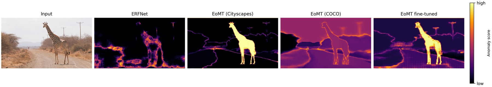

<h1 align="center">Anomaly Segmentation: Comprehensive Road Scene Understanding for Autonomous Driving</h1>

<h3 align="center">FAIMDL Exam Project - A.Y. 2025/2026</h3>

## Project Description
This repository contains the codebase for the **Anomaly Segmentation in Road Scenes** project.
The main objective of this work is the implementation, training, and comparative evaluation of semantic segmentation architectures (specifically the **ERFNet** baseline and the advanced **EoMT** model) for the task of *Anomaly Segmentation* and *Out-Of-Distribution (OOD) Detection* in urban autonomous driving scenarios.

The implemented pipeline supports anomaly mask extraction and the computation of standard evaluation metrics, such as AUPRC and FPR@TPR95, using several post-hoc scoring methods. Pixel-based baselines include MSP, MaxLogit, and MaxEntropy, while mask-based EoMT evaluations additionally support RbA. Temperature scaling is also considered as an additional calibration baseline.

## Authors
* **Simone Duma**
* **Giovanni Indiano**
* **Paolo Malugani**
* **Fabio Stradiotti**
## Results

📄 Full details in the [Project Report](Project%20Report.pdf).

<p align="center"></p>
<p align="center"><em>Anomaly maps (MSP) on RoadAnomaly21. The fine-tuned EoMT isolates the anomaly as a sharp, object-level mask, while ERFNet is dominated by boundary artifacts.</em></p>

### Key findings
- **Mask-based EoMT clearly outperforms pixel-based ERFNet**: up to 89.76% AuPRC / 0.44% FPR95 on SMIYC RO-21 (EoMT Cityscapes, MSP), vs. a maximum of 38.32% AuPRC for ERFNet on SMIYC RA-21.
- **Fine-tuning recovers the COCO domain gap**: mapping COCO to Cityscapes and fine-tuning the last 3 encoder blocks raises mIoU (17 classes) from 62.92% to 79.20%.
- **Best overall result**: fine-tuned EoMT + MaxEntropy reaches **91.74% AuPRC / 2.60% FPR95** on SMIYC RA-21.
- **Raw mask logits are poorly calibrated**: MaxLogit and RbA produce very high FPR95 on EoMT, while probability-based scores (MSP, MaxEntropy) are more reliable.
- **Temperature scaling is dataset-dependent**: no single T is optimal across benchmarks; T = 0.7 is used as a trade-off.

### Anomaly segmentation (AuPRC ↑ / FPR95 ↓, %)

| Model | Method | mIoU<sub>17</sub> | SMIYC RA-21 | SMIYC RO-21 | FS L&F | FS Static | Road Anomaly |
|---|---|:-:|:-:|:-:|:-:|:-:|:-:|
| ERFNet | MSP | 73.93 | 29.10 / 62.55 | 2.71 / 65.22 | 1.75 / 50.60 | 7.47 / 41.84 | 12.42 / 82.58 |
| ERFNet | MaxLogit | 73.93 | 38.32 / 59.34 | 4.63 / 48.44 | 3.30 / 45.49 | 9.50 / 40.30 | 15.58 / 73.25 |
| ERFNet | MaxEntropy | 73.93 | 30.97 / 62.66 | 3.04 / 65.91 | 2.58 / 50.16 | 8.84 / 41.55 | 12.67 / 82.75 |
| EoMT Cityscapes | MSP | 83.60 | 75.97 / 34.53 | **89.76 / 0.44** | 27.15 / 12.07 | 55.76 / 35.78 | **77.03 / 19.50** |
| EoMT Cityscapes | MaxEntropy | 83.60 | 68.21 / 27.34 | 85.39 / 0.73 | 6.44 / 29.99 | 12.94 / 53.82 | 52.09 / 45.22 |
| EoMT Cityscapes | RbA | 83.60 | 72.07 / 79.12 | 85.61 / 99.91 | 27.86 / 7.69 | 57.18 / 80.95 | 76.60 / 19.72 |
| EoMT COCO (zero-shot) | MSP | 62.92 | 35.59 / 87.79 | 1.00 / 99.99 | 1.70 / 96.62 | 7.08 / 96.61 | 21.49 / 94.28 |
| EoMT COCO fine-tuned | MSP | 79.20 | 80.13 / 15.38 | 62.99 / 1.66 | 31.89 / 20.25 | 77.63 / 13.45 | 70.86 / 27.73 |
| EoMT COCO fine-tuned | MaxEntropy | 79.20 | **91.74 / 2.60** | 85.50 / 6.77 | 12.18 / 34.87 | 35.98 / 61.73 | 68.53 / 35.69 |
| EoMT COCO fine-tuned | RbA | 79.20 | 43.92 / 92.83 | 50.25 / 99.94 | 30.96 / 91.50 | 80.88 / 76.43 | 68.18 / 71.09 |

*Selected rows; the complete table (including MaxLogit for all EoMT variants and the temperature-scaling ablation) is in the report.*

### Cityscapes semantic segmentation (mIoU, %)

| Model | 17-class subset | 19 classes |
|---|:-:|:-:|
| EoMT Cityscapes (native) | 83.60 | 81.68 |
| EoMT COCO, mapped zero-shot | 62.92 | – |
| EoMT COCO, fine-tuned (head only) | – | 73.00 |
| EoMT COCO, fine-tuned (last 3 blocks) | 79.20 | 76.13 |

---

## Repository Structure

For detailed instructions on running the scripts, please refer to the specific `README.md` files located inside each directory:

* [**anomaly_evaluation**](anomaly_evaluation/): Contains the unified pipeline (`evalAnomaly.py`) for anomaly extraction and evaluation with both models. Here you can also find the scripts for computing metrics and scoring functions.
* [**erfnet**](erfnet/): Contains the ERFNet architecture code, pretrained-weight directory, utilities, and standard semantic segmentation evaluation scripts.
* [**eomt**](eomt/): Contains the EoMT model code adapted for this project, including configuration files, training and fine-tuning scripts for Cityscapes, checkpoint-related resources, and the `eval_mIou.py` script for standard semantic segmentation evaluation. The anomaly segmentation evaluation of EoMT is handled by the unified pipeline in `anomaly_evaluation/`.

## Installation and Requirements

To run the scripts, you must install the required dependencies. Execute the following command from the project root:

```bash
pip install -r requirements.txt
```

*Note: **all commands must be executed from the root directory of the repository**.*

## Acknowledgments

This project builds on the following works and codebases:
- **EoMT** — Kerssies et al., *Your ViT is Secretly an Image Segmentation Model*, CVPR 2025 ([code](https://github.com/tue-mps/eomt), MIT License).
- **ERFNet** — Romera et al., *ERFNet: Efficient Residual Factorized ConvNet for Real-Time Semantic Segmentation*, IEEE T-ITS 2017.
- **RbA** — Nayal et al., *RbA: Segmenting Unknown Regions Rejected by All*, ICCV 2023.
- Benchmarks: [SegmentMeIfYouCan](https://segmentmeifyoucan.com/) and [Fishyscapes](https://fishyscapes.com/).
- Course project template: [MaskArchitectureAnomaly_CourseProject](https://github.com/AlessandroMarinai/MaskArchitectureAnomaly_CourseProject).
